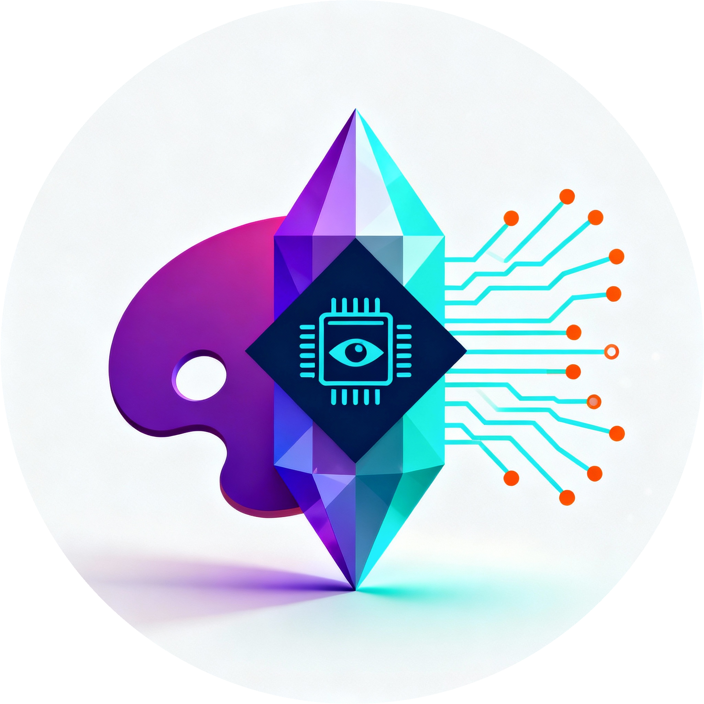

# Art-Gen MCP



**AI-powered image and video generation through the Replicate API**

In OpenCode, use the `generate-image` skill for image/video processing workflows and `art-gen-setup` when you explicitly want to install the collection's Bun dependencies. Setup does not generate media.


Art-Gen provides image and video generation scripts for the OpenCode `generate-image` skill. Create static images from text descriptions, edit existing images, animate images, or remove backgrounds. The skill resolves its references and scripts relative to its loader-provided canonical directory.

[](https://github.com/rjroy/vibe-garden/releases)
[](LICENSE)
[](https://bun.sh/)
[](https://modelcontextprotocol.io/)

---

## Features

- 🎨 **Text-to-Image Generation** - Describe your vision in natural language
- 🎬 **Image-to-Video Animation** - Transform static images into 5-second videos
- 🚀 **Multiple AI Models** - Flux, Stable Diffusion, SDXL, Imagen, Kling, Hailuo, and more
- ⚡ **Fast Performance** - Sub-500ms server overhead on top of API response time
- 📁 **Smart File Management** - Auto-incrementing filenames prevent overwriting
- 🔒 **Secure** - OAuth via Replicate API tokens, never stores sensitive data
- 🧰 **OpenCode Skills** - Use `generate-image` for media workflows and `art-gen-setup` only when installing Bun dependencies
- 🔄 **Log Rotation** - 10MB max per file, 5 backup files maintained
- 🛠️ **Model Discovery** - Query available parameters for any model

---

## Quick Start (5 Minutes)

### 1. Load the Skills

Use the OpenCode skill loader to make `generate-image` and `art-gen-setup` available. No plugin manifest is provided.

### 2. Set Up Replicate API

1. Sign up at [Replicate](https://replicate.com)
2. Get your API token from [replicate.com/account/api-tokens](https://replicate.com/account/api-tokens)
3. Create a `.env` file in the plugin directory:
   ```bash
   REPLICATE_API_TOKEN=r8_your_token_here
   ```

### 3. Use in OpenCode

**Image Generation:**
```
You: Generate an image of a serene mountain landscape at sunset

OpenCode: [Follows the generate-image skill and invokes the matching script]
✓ Image saved to: ./mountain-sunset.png
```

**Video Generation:**
```
You: Animate my character.png with gentle breathing motion

OpenCode: [Follows the generate-image skill and invokes the matching script after confirmation]
✓ Video saved to: ./character-breathing.mp4
```

---

## Use Cases

### Creative Prototyping

```
You: Generate 3 variations of a logo concept: minimalist tech startup with circuits

OpenCode: [Generates 3 images with different interpretations]
```

### Content Creation

```
You: Create a hero image for a blog post about renewable energy - solar panels in a field

OpenCode: [Generates high-resolution image optimized for web]
```

### Visual Brainstorming

```
You: Show me what a futuristic office space might look like in 2050

OpenCode: [Generates conceptual visualization]
```

### Rapid Iteration

```
You: Generate a cyberpunk cityscape, then make it more neon, then add rain

OpenCode: [Iterates through 3 versions based on feedback]
```

### Character Animation

```
You: Generate a portrait of a fantasy elf, then animate it with a gentle head turn

OpenCode: [Generates image, then creates 5-second video with motion after confirmation]
```

### Product Demos

```
You: Take my product-shot.png and animate it rotating 360 degrees

OpenCode: [Uses video generation to create rotating product showcase after confirmation]
```

### Social Media Content

```
You: Animate my logo.png with a pulsing glow effect for Instagram

OpenCode: [Creates 5-second looping video optimized for social after confirmation]
```

---

## Legacy MCP Tool Reference

The following tool schemas describe the retired MCP integration and are retained as historical reference only. They are not callable in the current OpenCode skill workflow; use the `generate-image` skill and its CLI scripts instead.

### `generate_image`

Generate AI images from text prompts with configurable parameters.

**Parameters**:
- `prompt` (required): Text description of the image
- `output_file_name` (required): Filename to save (e.g., "my-image.png")
- `model` (required): Model ID from the catalog (use `list_image_models` to see options)
- `parameters` (optional): Model-specific settings (aspect_ratio, quality, etc.)

**Example Response**:
```json
{
  "success": true,
  "model": "black-forest-labs/flux-2-pro",
  "prompt": "serene mountain landscape at sunset",
  "saved_files": [
    "/home/user/projects/mountain-sunset.png"
  ],
  "parameters": {
    "aspect_ratio": "16:9",
    "output_format": "png"
  }
}
```

### `list_image_models`

List available image generation models with descriptions and quality ratings.

**Example Response**:
```json
[
  {
    "model": "black-forest-labs/flux-2-pro",
    "description": "Use for final/polished images. Best quality and prompt adherence.",
    "cost": 0.05,
    "photorealism": 88,
    "artistic_quality": 82
  },
  {
    "model": "black-forest-labs/flux-schnell",
    "description": "Use for rapid iteration and drafts. Most cost-efficient at $0.003/image.",
    "cost": 0.003,
    "photorealism": 40,
    "artistic_quality": 35
  },
  ...
]
```

### `get_model_parameters`

Query available parameters for a specific model.

**Parameters**:
- `model` (required): Model ID (e.g., "black-forest-labs/flux-2-pro")

**Example Response**:
```json
{
  "model": "black-forest-labs/flux-2-pro",
  "parameters": {
    "aspect_ratio": {
      "type": "string",
      "default": "1:1",
      "options": ["1:1", "16:9", "9:16", "3:2", "2:3", "4:5", "5:4"],
      "description": "Aspect ratio of the generated image"
    },
    "resolution": {
      "type": "string",
      "default": "1 MP",
      "options": ["0.5 MP", "1 MP", "2 MP", "4 MP"],
      "description": "Output resolution in megapixels"
    },
    ...
  }
}
```

### `generate_video_replicate`

Generate 5-second 720p MP4 videos from static images using AI animation models.

**Parameters**:
- `image` (required): Path to input image file (PNG, JPG, JPEG, or WebP)
- `prompt` (required): Description of motion/action to apply
- `model` (required): Replicate model ID (use `list_video_models_replicate` to see options)
- `output_file_name` (required): Filename to save (e.g., "animated.mp4")
- `parameters` (optional): Model-specific settings (style, motion_mode, etc.)

**Fixed Constraints**:
- Resolution: 720p (1280x720)
- Duration: 5 seconds
- Format: MP4

**Example Response**:
```json
{
  "success": true,
  "model": "minimax/video-01-live",
  "prompt": "gentle breathing motion",
  "input_image": "/home/user/projects/character.png",
  "saved_files": [
    "/home/user/projects/character-breathing.mp4"
  ],
  "duration_seconds": 5,
  "resolution": "720p",
  "parameters": {
    "prompt_optimizer": true
  }
}
```

### `list_video_models_replicate`

List available video generation models organized by use-case category with cost information.

**Use-Case Categories**:
- **iteration**: Budget-conscious rapid prototyping (cheapest)
- **animation**: Live2D and anime-style animation
- **stylized**: Multiple style presets (anime, 3D, comic, cyberpunk)
- **photorealistic**: Live-action quality output
- **premium**: Maximum quality for production

**Example Response**:
```json
[
  {
    "model": "wan-video/wan-2.2-i2v-fast",
    "description": "Use for rapid iteration and budget-conscious prototyping",
    "use_case": "iteration",
    "cost_per_video": 0.11,
    "vendor": "Alibaba"
  },
  {
    "model": "minimax/video-01-live",
    "description": "Use for Live2D and animation content",
    "use_case": "animation",
    "cost_per_video": 0.50,
    "vendor": "MiniMax"
  },
  ...
]
```

### `get_video_model_parameters_replicate`

Query available parameters for a specific video generation model.

**Parameters**:
- `model` (required): Replicate model ID (e.g., "minimax/video-01-live")

**Example Response**:
```json
{
  "model": "pixverse/pixverse-v4",
  "parameters": {
    "image": {
      "type": "string",
      "required": true,
      "description": "First frame image (data URI)"
    },
    "prompt": {
      "type": "string",
      "required": true,
      "description": "Text description of video content"
    },
    "style": {
      "type": "string",
      "options": ["None", "anime", "3d_animation", "clay", "cyberpunk", "comic"],
      "default": "None",
      "description": "Artistic style preset"
    },
    ...
  }
}
```

---

## Available Models

### Image Models

| Model | Cost | Best For |
|-------|------|----------|
| **flux-2-pro** | $0.05 | Final/polished images - best quality and prompt adherence |
| **flux-schnell** | $0.003 | Rapid iteration and drafts - most cost-efficient |
| **ideogram-v3-balanced** | $0.06 | Images containing text - best text rendering |
| **recraft-v3-svg** | $0.08 | SVG vector format - scalable graphics |

**Recommendation**: Use `flux-2-pro` for production-quality images, `flux-schnell` for quick exploration.

### Video Models

| Model | Use Case | Cost/Video | Resolution | Best For |
|-------|----------|------------|------------|----------|
| **wan-2.2-i2v-fast** | Iteration | $0.11 | 720p | Budget prototyping, rapid testing |
| **video-01-live** | Animation | $0.50 | 720p | Live2D, anime characters |
| **pixverse-v4** | Stylized | $0.60 | 720p | Artistic styles (anime, 3D, comic) |
| **hailuo-02** | Photorealistic | $0.27 | 768p | Human motion, physics simulation |
| **kling-v2.5-turbo-pro** | Photorealistic | $0.35 | 720p | High-quality live-action |
| **kling-v2.1-master** | Premium | $1.40 | 1080p | Maximum quality production |

**All video models**:
- Fixed duration: 5 seconds
- Fixed format: MP4
- Input: Single image (becomes first frame)
- FPS: 16-30 depending on model

**Cost Considerations**:
- **Iteration workflow**: Use wan-2.2-i2v-fast ($0.11) for rapid testing, then upgrade for finals
- **Animation projects**: video-01-live optimized for Live2D and anime content
- **Photorealistic content**: hailuo-02 offers best cost/quality ratio at $0.27
- **Production work**: kling-v2.1-master provides 1080p output at $1.40

---

## Configuration

The plugin uses environment variables for configuration:

```bash
# Required
REPLICATE_API_TOKEN=r8_your_token_here

# Optional (set via launch scripts)
ART_INVOKE_DIR=/path/to/working/directory  # Auto-set by launch scripts
```

### Launch Scripts

Two launch scripts are provided for different environments:

**`art-gen.sh`** (1Password CLI):
- Uses `op run` to securely load environment variables
- Recommended for local development
- Requires 1Password CLI installed

**`art-gen-remote.sh`** (Direct .env):
- Sources `.env` file directly
- Use for remote/server environments without 1Password

Both scripts automatically:
- Capture invoke directory (`pwd`)
- Activate Python virtual environment
- Set `ART_INVOKE_DIR` for path resolution

---

## File Management

### Auto-Incrementing Filenames

Art-Gen **never overwrites existing files**. If a file already exists, it automatically increments:

```
mountain.png        # First generation
mountain_1.png      # Second generation
mountain_2.png      # Third generation
```

### Path Resolution

- **Relative paths**: Resolved from `ART_INVOKE_DIR` (the directory captured when the script was invoked)
- **Absolute paths**: Used as-is
- **Parent directories**: Created automatically if they don't exist

**Example**:
```
# Invocation directory: /home/user/projects/
# Request: output_file_name="images/sunset.png"
# Saved to: /home/user/projects/images/sunset.png
```

---

## Logging

Logs are written to `art-gen-mcp.log` in the current working directory.

**Log Rotation**:
- Max file size: 10MB
- Backup files kept: 5
- Handler: Python `RotatingFileHandler`

**Log Contents**:
- Tool invocations with arguments
- Replicate API calls and responses
- File save operations with paths
- Error traces with full exception details

---

## Documentation

- **[Tool Reference](docs/reference/TOOLS.md)** - Detailed tool usage and examples
- **[MCP Overview](docs/reference/MCP_OVERVIEW.md)** - Understanding the protocol
- **[Replicate API](docs/reference/REPLICATE_API.md)** - Model details and pricing
- **[Configuration](docs/reference/CONFIGURATION.md)** - Setup and environment variables
- **[Server Implementation](server/README.md)** - Technical implementation details

---

## Requirements

- **Bun**: Required to install and run the local TypeScript scripts
- **OpenCode**: Skill loader and shell tool available
- **Replicate Account**: Free tier available
- **API Token**: From replicate.com/account/api-tokens

---

## Installation (for Developers)

```bash
# Clone repository
git clone https://github.com/rjroy/vibe-garden.git
cd vibe-garden/plugins/art-gen

# Install the Bun dependencies used by the scripts
bun install
```

---

## Project Status

**Version**: 1.2.0
**Status**: Production Ready

**Completed**:
- ✅ Core image generation functionality
- ✅ Image-to-video animation (5s, 720p MP4)
- ✅ Multi-model support (4+ image models, 6 video models)
- ✅ Model parameter discovery (image and video)
- ✅ Use-case categorized video models (iteration, animation, photorealistic, premium)
- ✅ File collision prevention
- ✅ Log rotation (10MB, 5 backups)
- ✅ Dual launch scripts (1Password + direct .env)
- ✅ MCP protocol compliance

**Pending** (tracked in `.sdd/specs/art-gen-mcp-server.md`):
- Task breakdown from existing spec/plan
- Formal SDD progress tracking
- Comprehensive test suite
- Cost & quality metrics for models

---

## Performance

**Startup Time**: < 2 seconds
**Server Overhead**: < 500ms on top of Replicate API response
**File I/O**: < 1 second for images up to 10MB
**Async Execution**: Server remains responsive during generation

---

## Security

- API tokens loaded from environment only
- Tokens never logged or exposed in error messages
- File writes restricted to invoke directory scope
- Path traversal protection via absolute path validation
- No persistent storage of sensitive data

---

## Troubleshooting

### Server Won't Start
- Verify `REPLICATE_API_TOKEN` is set in `.env`
- Ensure virtual environment is activated
- Check `pip install -e .` completed successfully

### Image Generation Fails
- Confirm API token is valid at replicate.com/account
- Check you have sufficient credits
- Review model name for typos (use `list_image_models` tool)

### Video Generation Fails
- Verify input image exists and is supported format (PNG, JPG, JPEG, WebP)
- Check image dimensions are reasonable (most models support up to 1080p input)
- Confirm sufficient credits (video generation costs $0.11-$1.40 per 5-second video)
- Review model name for typos (use `list_video_models_replicate` tool)
- Note: Video generation takes 30-120 seconds depending on model

### Files Not Saving
- Check `ART_INVOKE_DIR` is set correctly
- Verify write permissions in target directory
- Review `art-gen-mcp.log` for detailed errors

### OpenCode Skill or Script Is Unavailable
- Confirm the collection's skills are available through the OpenCode skill loader
- Use `art-gen-setup` to install Bun dependencies if needed
- Resolve catalogs and scripts from the loaded `generate-image` skill's canonical directory, not the current working directory

---

## Contributing

Contributions welcome! This project uses [Spec-Driven Development (SDD)](../.sdd/README.md).

**To contribute**:
1. Review the spec at `.sdd/specs/art-gen-mcp-server.md`
2. Check the technical plan at `.sdd/plans/art-gen-mcp-server-plan.md`
3. Follow the SDD workflow: Specification → Planning → Tasks → Implementation
4. Submit pull requests with clear rationale

---

## License

MIT License - see [LICENSE](../LICENSE) file for details.

---

## Resources

- [Model Context Protocol Specification](https://spec.modelcontextprotocol.io/)
- [Replicate Documentation](https://replicate.com/docs)
- [Replicate Model Explorer](https://replicate.com/explore)
- [Vibe Garden Repository](https://github.com/rjroy/vibe-garden)

---

## Contact

**Author**: Ronald Roy
**Email**: gsdwig@gmail.com
**Repository**: [github.com/rjroy/vibe-garden](https://github.com/rjroy/vibe-garden)

---

<div align="center">

**Generate anything you can imagine 🎨**

*Part of the [Vibe Garden](https://github.com/rjroy/vibe-garden) ecosystem*

</div>
