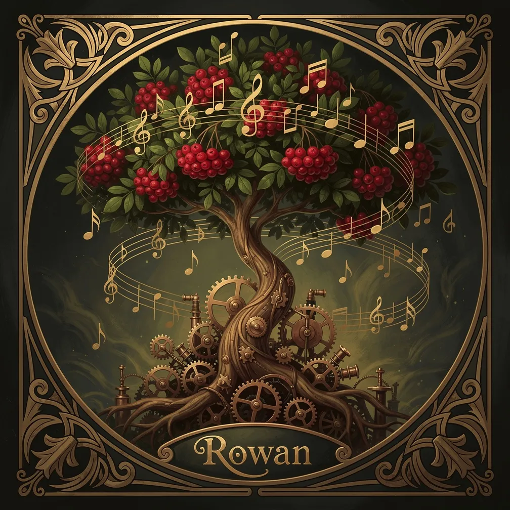

# Music Engine of Rowan



A songwriting and media-prompt collection for OpenCode/Slim, targeting Suno AI. Produces lyrics, production design, cover-art prompts, and video-hook prompts through a multi-agent pipeline with verbalized sampling at creative stages.

## Skills

| Command | What it does |
|---------|--------------|
| `music-write-lyrics` | Full two-phase songwriting pipeline: concept → lyrics → production → review → Suno-formatted output |
| `music-image-prompt` | Generates k=3 image prompt samples for cover art, with theme-specific art style guidance |
| `music-video-prompt` | Generates k=3 motion prompt samples for animating a static image into a video hook |
| `music-suno-output` | Formats reviewed songs for Suno; optional studio mode prepares per-segment style entries (text only) |
| `music-artwork` | Image and video artwork modes; paid rendering requires separate explicit approval |

## Songwriting Pipeline

`music-write-lyrics` delegates creative work through shared roles and explicit passive procedures; the parent skill handles selection and invokes output/artwork skills:

```
Phase 1 (you + user)
  Concept Development → k=5 concepts → user selects → save concept-approved.md

Phase 2 (three sub-agents)
  writer + music-engine-rowan-lyric-writer procedure → k=5 lyric approaches → parent confirms selection
  developer + music-engine-rowan-production-designer procedure → k=5 production designs → parent confirms selection
  reviewer + music-engine-rowan-song-reviewer procedure → fresh-eyes quality check → user approves fixes
  music-suno-output                      → copy-paste ready Suno Custom Mode output

Optional
  music-artwork                          → image/video prompts via prompt skills; rendering separately approved
  music-suno-output (studio mode)         → per-segment style entries for Suno's studio editor
```

Each creative call has an explicit procedure, scope, request, and inputs envelope. Legacy specialist IDs identify passive procedures, never dispatch targets. Each stage uses verbalized sampling: handlers generate k=5 genuinely distinct approaches (not variations), then the parent workflow recommends and presents alternatives for user selection before proceeding. It preserves full selected content, leaves samples/state unchanged on cancellation, and cleans up samples only after a successful write. The song reviewer uses a fresh invocation for each review, with no reused reviewer session.

## Themed Universes

Eight fictional worlds with distinct musical and visual identities:

| Theme | Sound | Setting |
|-------|-------|---------|
| **Telveran** | Haunting folk, memory-themed ballads | Reality shifts with collective memory |
| **Valdris** | Dark ambient, gothic rock | Ancient souls and spectral guardians |
| **Virelan** | Industrial folk, brass-heavy | Sacred steampunk, divine judgment through machinery |
| **Brightvale** | Theatrical pop, cabaret | Performance realm, authentic souls hiding behind facades |
| **Hope's Reach** | Ambient electronic, cosmic folk | Deep space vessel carrying humanity's musical heritage |
| **Trap Streets** | Urban folk, street poetry | Hidden pocket dimensions for the unwelcome |
| **Shattered Worlds** | Post-rock, ambient decay | Apocalyptic exploration of the mundane |
| **Insert Name** | Synthwave, introspective beats | Cyber world, personal development |

Themes are optional. Songs without a theme use universal concepts directly.

## Lens Transformations

Lenses reframe any theme (or no theme) into a different emotional register:

- **Work Empowerment** — High-energy motivational anthems for career and productivity
- **Epic** — Hero's journey structure for grand, transformational narratives
- **Lo-fi** — Warm, steady, background-compatible music for study or relaxation
- **Comedy** — Satirical and humorous takes on any subject
- **Universal Resonance** — Broad human experiences and timeless emotions

Combine freely: Epic + Telveran, Lo-fi + Hope's Reach, Comedy + Virelan.

## MIDI Lyric Analysis

If you have a MIDI file, the `midi-lyric-analyzer` skill extracts melodic motifs, phrase lengths, syllable counts, and stress patterns before writing begins. The resulting Lyrical Blueprint becomes a binding constraint for all five lyric samples, ensuring lyrics fit the melody naturally rather than fighting it.

Use from within the `music-write-lyrics` flow when a MIDI source should constrain the lyrics.

## Skills

| Skill | Role |
|-------|------|
| `music-engine-reference` | Reference library: theme files, lens files, theory modules, image guidance, and video guidance. |
| `midi-lyric-analyzer` | Analyzes MIDI files and generates a Lyrical Blueprint for syllable-accurate lyric writing. |

## Output Files

Songs are saved to `song-[title-slug]-[YYYYMMDD]/concept-approved.md` in your working directory, with phase metadata tracking progress through the pipeline. Samples files (`lyrics-samples.md`, `production-samples.md`) are created by the authorized writer/developer procedure and deleted by the parent only after selection is successfully written and verified.

Image and video prompt samples are written to the workspace as `image-prompt-samples-[concept-slug]-[date].md` and `video-prompt-samples-[concept-slug]-[date].md`.

## Dependencies

Prompt skills produce prompt samples only. `music-artwork` rendering requires a separately available integration and explicit user approval for each generation and retry; prompt selection is not rendering permission.
