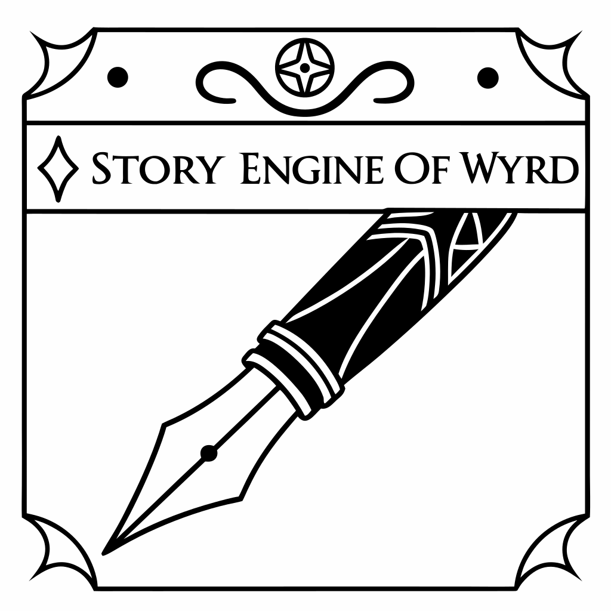

# Story Engine of Wyrd



A prose fiction system for creating stories across multiple formats, fictional worlds, and genre lenses. Built for writers who want collaborative AI assistance without surrendering authorship.

## Features

### Multi-Format Support
- **Flash Fiction** — Single chapter, complete story
- **Short Story** — 2–5 chapters, contained narratives
- **Epic** — 6–15 chapters, expansive world-building
- **Serialized** — 15+ chapters, novel-length narratives

### Six Distinct Story Worlds
Each world has unique mechanics, character archetypes, and narrative conventions:

- **Telvaren** — Memory-shifting reality where what's remembered becomes truth
- **Valdris** — Gothic realm with death as a navigable threshold
- **Virelan** — Sacred industrial steampunk where divine judgment operates through machinery
- **Brightvale** — Performance vs authenticity in a world of emotional survival
- **Hope's Reach** — Deep space vessel where music is survival technology
- **Trap Streets** — Hidden pocket dimensions for the unwelcome and displaced

### Genre Lenses
Transform stories across worlds using thematic lenses: mystery, romance, horror, coming-of-age.

### Verbalized Sampling
Instead of single outputs, the engine generates 5 distinct candidate approaches with probabilities for each creative decision. You select the best direction, reducing mode collapse and improving creative diversity.

### Persistent State
All work saves to `.story-state/` with metadata tracking, allowing resumption from any chapter or creative phase.

## Skills

- **`story-write-story`** — Main resumable story-creation workflow, with user approval gates for concept selection, plan approval, and chapter-quality decisions.
- **`story-review-story`** — Informational, read-only continuity review of an existing story bible.
- **`story-plan-plot`** — Collaborative plot planning, structure troubleshooting, and outline refinement.
- **`story-develop-character`** — Collaborative character creation and refinement.

Invoke a skill conversationally by asking for its described task; provide a story directory, outline, or resume plan path when relevant. Slash-command syntax is no longer used.

## Specialized Agents

The system delegates concept development, character building, and prose generation to three retained agents:

- **`story-engine-wyrd-concept-developer`** — Explores story premise, identifies core conflicts, and validates world fit
- **`story-engine-wyrd-character-builder`** — Develops detailed character profiles with depth and consistency
- **`story-engine-wyrd-prose-writer`** — Executes chapter writing with attention to voice, pacing, and sensory detail

The `story-write-story` parent handles all sample selection and workflow state. The shared **`story-engine-wyrd-story-reviewer`** is invoked fresh in quality, continuity, or final-review mode; it is read-only and returns findings. The parent applies review outcomes to schema-defined frontmatter/metadata and handles any user-approved revisions. Review does not grant permission to edit story files without user approval.

## Skills

### `story-engine-reference`
Passive reference library providing access to story worlds, narrative theory modules, genre lenses, and format guidelines. The story planning and character skills load relevant materials as needed.

### `story-compiler`
Aggregates completed chapters into final story documents with metadata, formatting, and optional export.

## Workflow

1. **Concept** — Specify format, world (optional), and story premise
2. **Planning** — Develop plot outline and character profiles
3. **Writing** — Generate chapters with verbalized sampling for creative decisions
4. **Review** — Multi-pass quality and continuity checking
5. **Iteration** — Resume at any point to revise or extend

## Story State

Stories store work in `.story-state/[StoryName]/`:

```
.story-state/Cyberpunk-Heist/
├── metadata.json          # Progress tracking
├── PLAN.md               # Plot outline
├── characters.md         # Character profiles
├── chapter-1.md
├── chapter-2.md
└── ...
```

Resume any story by asking to continue and providing its PLAN.md path.

## Getting Started

1. **Write a story:** Ask for a story in natural language and include any format, world, or premise details you already know.
2. **Let the engine guide you:** Respond to format and world questions
3. **Make creative decisions:** Select between 5 candidate approaches for each chapter
4. **Review and iterate:** Ask for an informational continuity review of the story directory

## Theory and Craft

The engine draws from narrative craft fundamentals covering:
- Story structure and pacing
- Character development and motivation
- Prose craft and voice
- Dialogue and interaction
- World-building and setting

Reference these modules throughout the writing process for craft guidance.

## Philosophy

The Story Engine is built on three principles:

1. **Collaborative, not substitute** — You decide what happens; the engine handles execution
2. **Judgment stays with you** — Verbalized sampling gives you options, not decisions
3. **Persistent and resumable** — Your work survives interruption; resume from anywhere

## License

MIT

## Author

Ronald Roy (gsdwig@gmail.com)
